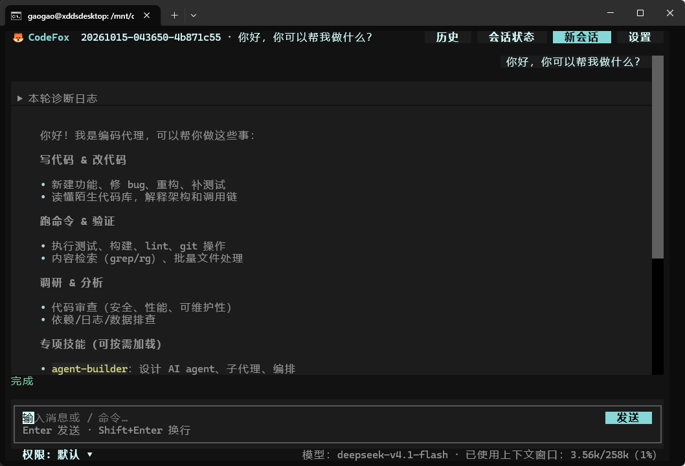

<p align="center">
  
</p>

<h1 align="center">CodeFox</h1>

<p align="center">本地运行的代码 Agent 环境，提供命令行交互和终端工作台。</p>
<p align="center">让 Agent 阅读代码、修改文件、执行命令，也可以把独立工作交给子 agent。</p>
<p align="center">
  <a href="#主要功能">主要功能</a> ·
  <a href="#快速开始">快速开始</a> ·
  <a href="#常用命令">常用命令</a> ·
  <a href="#仓库导航">仓库导航</a>
</p>

## 主要功能

- **代码任务**：查找和读写文件、执行 Shell 命令、维护 TODO 与任务板。
- **子 agent 协作**：委派一次任务，或在同次运行中保留助手并分派后续工作。
- **会话管理**：保存对话、工具记录、目标与 TODO，恢复后继续交流。
- **上下文与目标**：自动或手动压缩历史；设置目标后评估是否需要继续执行。
- **工作流**：用程序组织顺序和并行步骤，管理用量预算并恢复已完成步骤。
- **扩展能力**：支持技能、MCP 工具和可选的长期记忆。

## 快速开始

需要 Python 3.10+ 和 Git。日常开发与验证使用 WSL2，以下以 Linux / WSL 的 Bash 终端为例。

### 1. 安装

克隆或下载仓库后，在仓库根目录执行：

```sh
python -m venv .venv
source .venv/bin/activate
python -m pip install -e ".[tui]"
cp .env.example .env
```

只使用普通 CLI 时，安装命令改为 `python -m pip install -e .`。conda 等环境的安装方式见 [环境与调试说明](note/README.md)。

<details>
<summary>Windows PowerShell 的环境准备命令</summary>

```powershell
python -m venv .venv
.\.venv\Scripts\Activate.ps1
python -m pip install -e ".[tui]"
Copy-Item .env.example .env
```

</details>

### 2. 配置模型

编辑仓库根目录的 `.env`，填写 API key 和模型 ID：

```dotenv
ANTHROPIC_API_KEY=your-api-key
MODEL_ID=your-model-id
```

默认使用 Anthropic Messages 协议。连接兼容服务时，再填写 `ANTHROPIC_BASE_URL`。
按模型和服务端实际支持的上下文窗口设置 `MODEL_CONTEXT_TOKENS`，运行时用它计算压缩阈值和工具输出预算。

<details>
<summary>使用 OpenAI Responses 协议</summary>

将 `.env` 中的模型配置替换为：

```dotenv
LLM_API=responses
MODEL_ID=your-model-id
OPENAI_API_KEY=your-api-key
OPENAI_BASE_URL=https://api.example.com/v1
```

`OPENAI_BASE_URL` 填写所用服务的地址；`ANTHROPIC_BASE_URL` 保持未设置。
需要指定完整请求地址时，使用 `LLM_RESPONSES_URL`。

</details>

更多配置见 [.env.example](.env.example)。长期记忆默认关闭，设 `AGENT_MEMORY_ENABLED=1` 后启用；提取与整理记忆会额外调用模型。

### 3. 启动并发送任务

```sh
# 普通命令行
codefox

# CodeFox 终端工作台
codefox tui
```

安装后可以切换到要工作的项目目录再启动。首次体验也可以直接在本仓库中输入：

```text
请梳理这个项目的代码结构，说明主程序从哪里启动，并列出关键文件路径。不用修改文件。
```

TUI 中 Enter 发送、Shift+Enter 换行，点击“停止”或按 Ctrl+C 停止当前回合，Ctrl+D 保存并退出。
工具详情可以展开查看，顶部入口用于管理历史会话、查看会话状态和调整设置。

### 界面预览

<p align="center">
  
</p>

默认权限模式允许工作区内的文件读写；需要确认的 Shell 命令、目录外文件访问和 MCP 操作会请求批准。
CLI 显示 `Allow? [y/N]`，TUI 显示审批卡。

<details>
<summary>从源码运行，不安装项目包</summary>

Python 模块名为 `codefox`。环境中已有项目依赖时，在仓库根目录运行：

```sh
PYTHONPATH=src python -m codefox
PYTHONPATH=src python -m codefox tui
```

Windows PowerShell：

```powershell
$env:PYTHONPATH = "src"
python -m codefox tui
```

</details>

## 常用命令

CLI 与 TUI 共用以下命令：

| 命令                | 作用                     |
| ------------------- | ------------------------ |
| `/goal`             | 查看当前目标             |
| `/goal <目标>`      | 设置目标并开始执行       |
| `/goal clear`       | 清除目标                 |
| `/compact`          | 压缩当前会话上下文       |
| `/new`              | 保存当前会话并开启新会话 |
| `/resume`           | 查看历史会话             |
| `/resume <会话 ID>` | 恢复指定会话             |
| `/delete <会话 ID>` | 删除非活动会话           |
| `/quit`             | 保存并退出               |

会话自动保存在 `~/.agent-harness/sessions/`。恢复时会切回原启动目录，读取保存的上下文与展示记录；旧的后台线程和子 agent 不会重启。
切换会话前需要先结束当前回合，并处理仍在运行或待交付的后台工作。原目录或关联工作树失效时会提示错误。

任务、工作树、工作流记录等运行数据按会话启动目录保存；同一目录只运行一个交互进程。

## 让子 agent 分工

直接描述需要助手完成的工作即可。例如，委派一次阅读任务：

```text
请安排一个助手阅读项目根目录的 README.md，整理项目用途、启动方式和常用命令。等它完成后，给我一份简短的中文说明，只需要总结，不用修改文件。
```

需要连续配合时，可以让同一个助手保留上下文，完成后再分派下一项工作。
直接说明任务和是否需要后续协作，模型会选择执行模式、工具和通信方式。

## 离线工作流演示

完成环境准备后，在同一目录依次执行：

```sh
codefox workflow demo
codefox workflow resume
```

演示使用模拟模型，不请求真实 API、不消耗模型额度。`demo` 运行代码审查示例并将步骤记录写入 `.runtime/`，`resume` 重放已完成的调用。
启动仍会读取模型配置，可以保留 `.env.example` 中的占位 key 和模型 ID。

## 仓库导航

阅读代码时，从目录 README 逐层进入：先了解本层职责，再查看子目录的文件分工。
开发检查的运行方法和测试覆盖范围由对应目录维护。

| 入口 | 内容 |
| --- | --- |
| [src/](src/README.md) | Python 源码入口，继续进入 `codefox/` 查看模块分工 |
| [tests/](tests/README.md) | 开发依赖、离线测试、覆盖归属和真实 API 测试入口 |
| [scripts/](scripts/README.md) | 离线端到端自检、模拟交互和架构图生成 |
| [docs/](docs/README.md) | 当前行为约束、设计计划、调研与验收记录 |
| [note/](note/README.md) | 通用环境安装，以及维护者的本机运行与调试笔记 |
| [GLOSSARY.md](GLOSSARY.md) | 会话、上下文、任务与工作目录等术语 |
| [pyproject.toml](pyproject.toml) | Python 版本要求、依赖、可选安装项和命令入口 |
