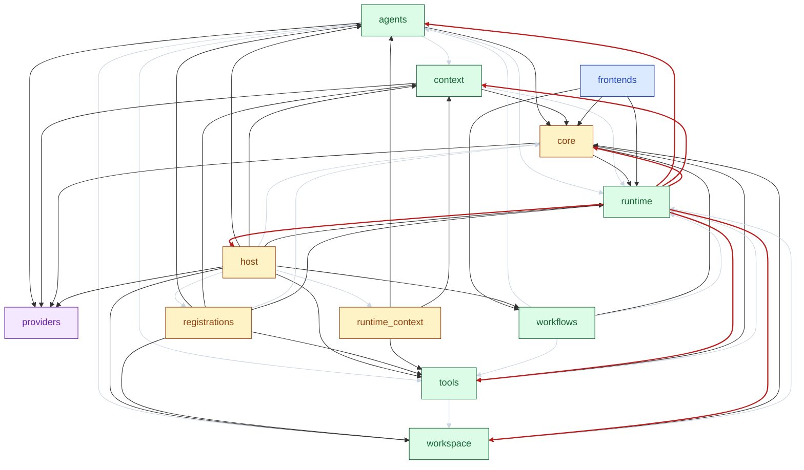

# 模块依赖图

由 `scripts/arch_views.py` 生成，请勿手改。重新生成：

```bash
python scripts/arch_views.py
```

## 图例 · 线的含义

| 线型 | 含义 | 说明 |
| --- | --- | --- |
| 深色实线 | 跨层依赖 | 架构主干 |
| 浅灰细线 | 同层依赖 | 弱化显示 |
| 红色实线 | 回边 | 指向层序上方的反馈边；删掉这些边后，其余依赖可排成无环的层序 |

## 节点颜色

蓝=入口，黄=装配，绿=核心，紫=底层。

## 循环依赖（需收敛）

下面每个强连通分量是一个循环；红线是用贪心法挑出的反馈边集合（不保证最少），收敛目标就是消除这些回边。

- agents ↔ context ↔ core ↔ host ↔ registrations ↔ runtime ↔ runtime_context ↔ tools ↔ workflows ↔ workspace

节点是 `agent_harness` 的子包与顶层模块，箭头 `A --> B` 表示 A 导入 B。
全部依赖都在图上，没有省略；同层边只是弱化，不会藏住问题。
VS Code 中打开本文件按 `Ctrl+Shift+V` 预览；AI 读同目录的纯文本 `deps.mmd`。


