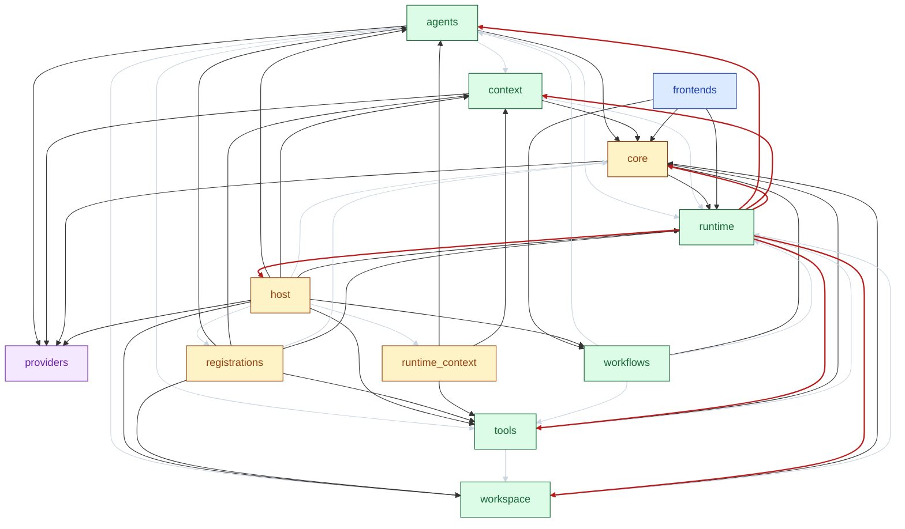

# 模块依赖图

由 `scripts/arch_views.py` 生成，请勿手改。重新生成：

```bash
python scripts/arch_views.py
```

## 图例 · 线的含义

| 线型 | 含义 | 说明 |
| --- | --- | --- |
| 深色实线 | 跨层依赖 | 架构主干 |
| 浅灰细线 | 同层依赖 | 弱化显示 |
| 红色实线 | 回边 | 按图的层序选出的反馈边，用于定位跨职责依赖，不代表该依赖必须删除 |

## 节点颜色

蓝=入口，黄=装配，绿=核心，紫=底层。

## 包级相互依赖

下面是聚合到职责包后的强连通分量。不同文件的依赖聚合后可能形成包级循环，不能据此认定存在 Python 文件导入环。

- agents ↔ context ↔ core ↔ host ↔ registrations ↔ runtime ↔ runtime_context ↔ tools ↔ workflows ↔ workspace

红线由贪心法选择（不保证最少）；是否调整依赖，需要继续核对具体文件的职责、状态归属和调用顺序。

## Python 文件静态导入环

- codefox.context.compaction ↔ codefox.context.prompt_state ↔ codefox.core ↔ codefox.runtime.session_store ↔ codefox.workspace.tasks ↔ codefox.workspace.worktrees

此检查包含函数内的延迟导入，不执行代码，也不覆盖动态导入。

节点是 `codefox` 的子包与顶层模块，箭头 `A --> B` 表示 A 导入 B。
全部依赖都在图上，没有省略；同层边只是弱化，不会藏住问题。
VS Code 中打开本文件按 `Ctrl+Shift+V` 预览；AI 读同目录的纯文本 `deps.mmd`。


