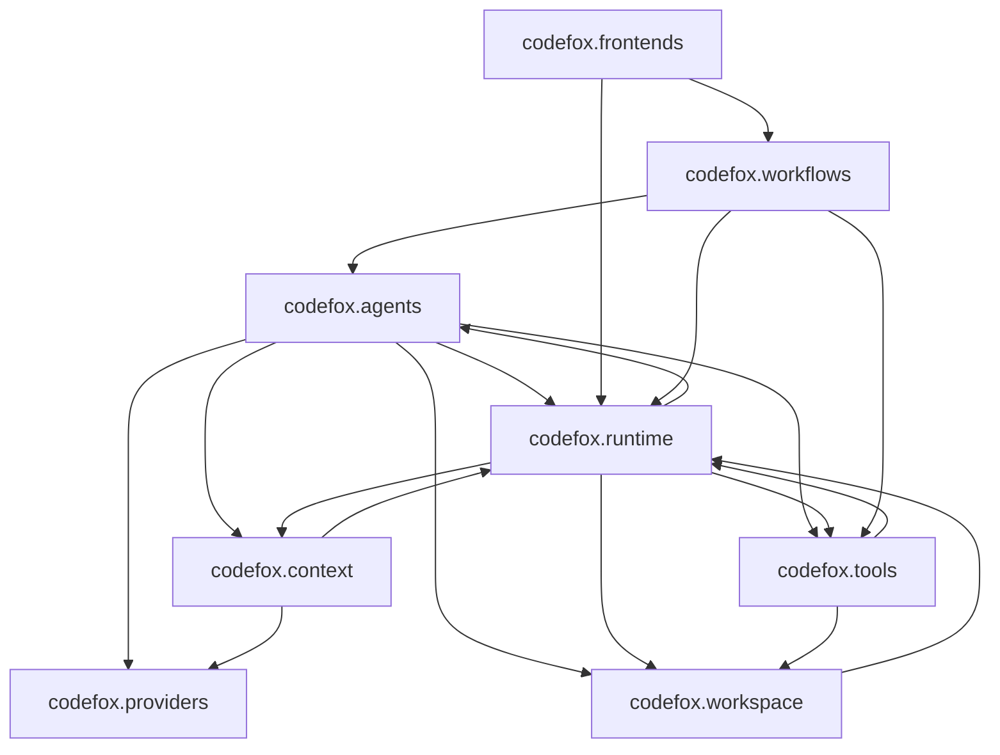

# 代码架构可视化工具调研（agent-harness 适用）

调研日期：2026-10-10。范围：用哪些工具把本项目（Python、`src/codefox/` 8 个子包）的架构与依赖画出来。
一手来源：各工具官方文档 / 官方仓库 / PyPI 元数据（文末列出）。所有"实测"结论来自在本仓库或本仓库副本上直接运行。

## 结论

- 工具分四层，按需求选，不要混用：**结构层**（模块/类依赖，静态）→ **代码层**（类与函数结构，静态）→ **行为层**（调用/控制流：静态静态分析或运行时追踪）→ **模型层**（人工绘制的架构图）。
- 本机（WSL `learncc` 与 Windows）**都没有 Graphviz 的 `dot`**。凡是"必须 `dot` 才能出图"的工具，在当前环境只能出中间文本，不能出图。优先选原生出 Mermaid/HTML 的工具。
- 首选组合（投入产出最高，全部无需 `dot`）：
  1. `tach` —— 模块依赖图 + 边界约束，一个工具两用。`tach show --mermaid` 出依赖图，`tach check` 把边界写成可执行约束。
  2. `pyreverse`（pylint 自带）—— 类图 + 包图，`-o mmd`/`-o html` 原生输出 Mermaid/HTML。
  3. `pyan3 --text` —— 静态函数级调用图，输出可读文本，适合喂给 AI 或人看（渲染成图片才需要 `dot`）。
  4. `viztracer` —— 运行时函数调用可视化，直接出可交互 HTML（火焰图/时序图），无需 `dot`；看"实际跑了哪些函数、谁调谁、各花多久"。
- 人工架构模型用 **Structurizr DSL**（C4 模型参考实现）或 **D2**，用来把 04 计划里的模块边界画成稳定、可版本管理的图。

## 工具清单

| 工具 | 产物 | 需要 `dot`？ | 版本 / 最近发布 | 许可 | 适用层 |
| --- | --- | --- | --- | --- | --- |
| tach | 模块依赖图（Mermaid/DOT）、边界校验 | 否 | 0.35.3 / 2026-10-06 | MIT | 结构 |
| pyreverse（pylint） | 类图、包图（dot/gv/puml/mmd/html） | 仅位图格式需要 | pylint 4.1.2 | GPL-2.0 | 结构 |
| pydeps | 模块依赖图（svg/png）、依赖 JSON | 出图需要 | 3.0.9 / 2026-10-01 | BSD-2-Clause | 结构 |
| pyan3 | 函数级调用图（dot/svg/text） | 出图需要 | 2.9.0 / 2026-10-06 | GPL-2.0 | 行为 |
| code2flow | 函数级流程图（DOT/JSON） | 出图需要 | 2.5.1 / 2023-01-08 | MIT | 行为 |
| viztracer | 运行时函数调用图（可交互 HTML/JSON） | 否 | 1.1.1 / 2025-11-11 | Apache-2.0 | 行为（动态） |
| grimp | 可查询的导入图（库，无 CLI） | 否 | 3.17 / 2026-09-04 | BSD-2-Clause | 结构 |
| import-linter | 依赖边界约束（无图） | 否 | 2.15 / 2026-09-04 | BSD-2-Clause | 约束 |
| radon / wily | 圈复杂度、可维护性指数 | 否 | 6.0.1 / 1.25.0 | MIT | 度量 |
| D2 | 任意架构图（DSL → 图） | 否 | 25.6k★ | MPL-2.0 | 模型 |
| Structurizr DSL / Lite | C4 模型图（DSL → 多视图） | 否 | C4 参考实现 | Apache-2.0 | 模型 |
| mermaid-cli（`mmdc`） | 把 `.mmd` 渲染成 svg/png/pdf | 否 | 5080★ | MIT | 渲染 |

已归档、不建议新引入：`PyCG`（0.0.8，仓库 archived）、`pycallgraph`（`gak/pycallgraph` archived）、`pycallgraph2`（2019 年后未更新）、`snakefood`（2009）。

### 有没有一个工具全包三层？

结论：**没有**开源工具能同时免 `dot`、又把这三种图都做好。最接近的是三个，各有硬伤。

| 工具 | 覆盖 | 硬伤 | 状态 |
| --- | --- | --- | --- |
| Doxygen | 类图、调用图、依赖图、目录结构图（一条命令出一个 HTML 站点） | 所有图都依赖 Graphviz `dot`；Python 的调用图解析质量有限 | 开源，活跃 |
| PyCharm / IntelliJ | 类图、调用层级、依赖分析（交互式） | 架构层（包/模块图）弱；Profiler 调用图需 Pro | 商业 IDE |
| SciTools Understand | 依赖图、butterfly、类图、调用图，三层最完整 | 商业闭源、付费；不在 pip | 商业 |

- Doxygen 官方特性页写明图能力由 Graphviz `dot` 提供（`HAVE_DOT` 打开才出图），`CALL_GRAPH`/`CLASS_GRAPH`/`COLLABORATION_GRAPH` 都属 dot 依赖项。
- PyCharm 的 Python Class Diagram 由内置 Diagrams 插件提供（Community 可用），Profiler 的运行时调用分析仅 Pro。
- 曾最贴近"一个工具全包"的是 **Sourcetrail**（依赖图 + 类视图 + 调用图，支持 Python），但仓库已于 2021-12 归档、只读，不建议新引入。

实践上，`tach` + `pyreverse` + `viztracer` 的三件套比找全包工具更简单、每层质量更高，且全程不需要 `dot`。若只是想要"一个入口"，写个脚本把三者产物输出到同一个目录即可。
## 本仓库实测记录

仓库规模（实测）：`src/codefox/` 59 个 `.py`、12,858 行；`tests/` 26 个 `.py`、8,666 行；顶层 8 个子包：`agents`(8) `context`(5) `frontends`(8) `providers`(3) `runtime`(12) `skills`(4) `tools`(6) `workflows`(3) `workspace`(4)。

### tach：模块依赖图（推荐）

需要在项目根放 `tach.toml`。最小可用配置是 `source_roots` 加每个模块一个 `[[modules]]`，再 `tach sync` 自动补 `depends_on`：

```toml
source_roots = ["."]

[[modules]]
path = "codefox.runtime"
```

```bash
uvx tach sync            # 用实际依赖补全 depends_on
uvx tach show --mermaid  # 生成 tach_module_graph.mmd
uvx tach check           # 校验边界是否被违反
```

实测 8 个子包的依赖（`tach show --mermaid` 输出）：



注意：`runtime` ↔ `agents`/`context`/`tools`/`workspace`、`tools` ↔ `runtime`、`agents` ↔ `runtime` 都是**双向**，即存在包级循环依赖。这正是 04 计划（整体运行期职责深化）要收敛的对象，`tach check` 可以把"不得新增循环"变成可执行约束。

### pyreverse：类图与包图

```bash
uvx --from pylint pyreverse -o mmd -p codefox src/codefox   # 出 .mmd
uvx --from pylint pyreverse -o html -p codefox src/codefox  # 出 .html
```

实测：`Analysed 54 modules with a total of 77 imports`，产出 `classes_codefox.mmd`、`packages_codefox.mmd` 及对应 `.html`。`-o mmd/html` 不需要 `dot`；`-o png/svg` 才需要。

### pyan3：函数级调用图

```bash
uvx --from pyan3 pyan3 src/codefox --text --depth 1        # 文本，无需 dot
uvx --from pyan3 pyan3 src/codefox --dot --colored --no-defines --concentrate
```

实测 `--text` 输出形如 `APIConnectionError\n    [U] LLMClientError`（"谁使用了谁"）；`--dot` 出 DOT；`--svg` 直接渲染需要 `dot`，本机失败。

### pydeps：依赖 JSON / 图

```bash
uvx --from pydeps pydeps codefox --show-deps --no-output   # 出依赖 JSON，无需 dot
uvx --from pydeps pydeps codefox -T svg                    # 出图，需要 dot
```

实测 `--show-deps` 正常输出每模块的 `bacon` 与 `imports` 列表；不加 `--no-output` 出图时因缺 `dot` 报 "No dependencies to draw"。

### viztracer：运行时函数调用可视化

```bash
uvx viztracer --output_file out.html demo.py   # 可交互 HTML（火焰图 + 时序）
uvx viztracer --output_file out.json demo.py   # 原始 trace JSON
```

实测：对一个三函数脚本运行后生成约 2.6 MB 的 `out.html`（Chromium tracing 格式，可直接浏览器打开）与 `out.json`；`--open False` 不是合法写法，不要传（会报 `No such file as False`）。产物是**运行时真实调用**，比静态调用图更贴近实际执行，但需要真正跑起来，且只覆盖被执行的路径。
## 与本项目的关系

- 04 计划的核心是"深模块 / seam / 边界"，恰好需要**结构层图**来验证边界，**约束层工具**来防止边界回退。`tach`（图 + 约束）与 `import-linter`（约束）能把这层写成可执行规则。
- `tach` 的依赖输出与计划中的模块划分可直接对照，用于"改前 / 改后"对比。
- 若要一张能长期维护、含人为语义的架构图，用 Structurizr DSL 或 D2 手写，而不是自动生成。
- 静态与动态互补：`pyan3`/`code2flow` 看"代码里可能怎么调"，`viztracer` 看"这次实际怎么调"。排查运行期问题时用后者。

## 环境与落地建议

- 本机 `uv`/`uvx` 位于 `~/.local/bin`，可用 `uvx <tool>` 临时运行，**不污染 `learncc` 环境**，符合"装新依赖前先告知用户"。
- 不把 Graphviz 设为项目硬依赖；需要位图时用 `mmdc`（mermaid-cli）渲染 `.mmd`，或临时装 `dot`。
- 若采纳 `tach`：`tach.toml` 入库作为边界的单一权威来源，`tach check` 作为可选的离线自检项（与 `scripts/debug_pass.py` 并列），需要用户确认后再纳入不变量。
- 动态可视化会真实执行代码，只对可安全离线运行的目标用 `viztracer`；本项目可用 `scripts/debug_pass.py` 之类的离线入口做追踪，不触发真实 API 调用。
- 依赖都走 `uvx` 临时环境，无需安装、不污染 `learncc`；需要长期使用时再和用户确认写入 `pyproject.toml`。

## 来源

- tach：<https://docs.gauge.sh/>（`tach show` / `tach check` / `tach sync`）、<https://github.com/tach-org/tach>
- pyreverse：<https://pylint.readthedocs.io/en/stable/additional_tools/pyreverse/index.html>
- pydeps：<https://pydeps.readthedocs.io/en/latest/>、<https://github.com/thebjorn/pydeps>
- pyan3：<https://github.com/Technologicat/pyan>
- code2flow：<https://github.com/scottrogowski/code2flow>
- grimp：<https://github.com/python-grimp/grimp>
- import-linter：<https://import-linter.readthedocs.io/en/stable/>
- D2：<https://d2lang.com/tour/intro/>
- Structurizr DSL：<https://structurizr.com/>、<https://docs.structurizr.com/dsl>
- mermaid-cli：<https://github.com/mermaid-js/mermaid-cli>
- viztracer：<https://github.com/gaogaotiantian/viztracer>
- Doxygen：<https://www.doxygen.nl/manual/features.html>、<https://www.doxygen.nl/manual/config.html>（`HAVE_DOT`/`CALL_GRAPH`/`CLASS_GRAPH`）
- PyCharm：<https://www.jetbrains.com/help/pycharm/class-diagram.html>、<https://www.jetbrains.com/help/pycharm/profiler.html>
- Sourcetrail（已归档）：<https://github.com/CoatiSoftware/Sourcetrail>
- 版本与维护状态：PyPI JSON API（`https://pypi.org/pypi/<包名>/json`）与 GitHub REST API，2026-10-10 取值。
