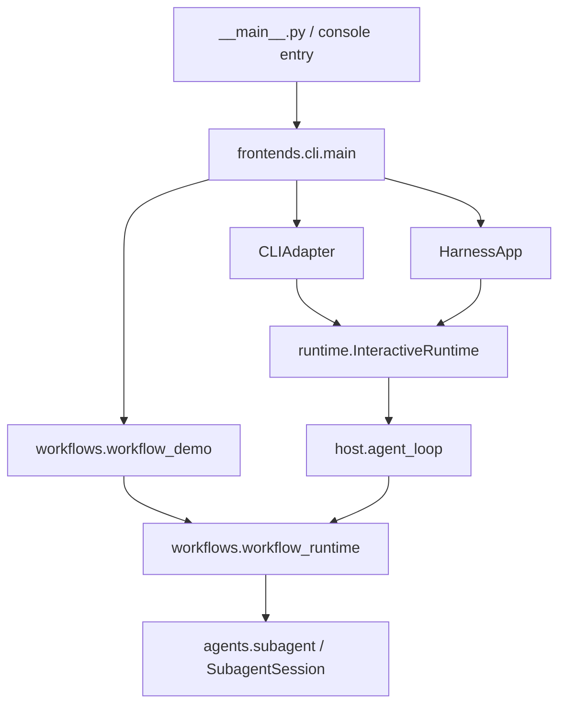

# agent_harness 源码结构

本包按职责分成 8 个子包。模块保留具体实现，包根目录保留共享配置、Lead 主循环和装配代码。
运行命令、环境和验证步骤见 [项目 README](../../README.md)。

## 从哪里开始读

| 目录 | 职责与阅读入口 |
| --- | --- |
| [frontends/](frontends/README.md) | CLI 和 Textual 输入、显示及交互适配 |
| [runtime/](runtime/README.md) | 交互驱动、事件与审批、命令、会话存储、调度和 hooks |
| [agents/](agents/README.md) | 子 agent 生命周期、共享执行回合、goal 和错误恢复 |
| [context/](context/README.md) | 提示词、历史压缩、memory 和技能加载 |
| [providers/](providers/README.md) | 模型 API 协议适配与消息内容读取 |
| [tools/](tools/README.md) | 基础工具、MCP 与工具注册机制 |
| [workspace/](workspace/README.md) | 任务板、任务分配及 Git 工作树 |
| [workflows/](workflows/README.md) | 程序化工作流、预算、journal 和恢复 |
| [skills/](skills/) | 随包分发的技能资产；每项技能由自己的 `SKILL.md` 说明 |

## 根目录文件

| 文件 | 职责 |
| --- | --- |
| [__init__.py](__init__.py) | 标识 Python 包，不执行装配 |
| [__main__.py](__main__.py) | `python -m agent_harness` 入口，交给 `frontends.cli.main` |
| [core.py](core.py) | 启动目录、配置、模型客户端、常量、控制台协调器及技能资源路径 |
| [host.py](host.py) | Lead 的 `agent_loop`；接入工具、上下文、goal、子 agent 和工作流，保留现有调用入口 |
| [registrations.py](registrations.py) | 工具 schema 和 handler 的具体清单，将工具名接到实现 |
| [runtime_context.py](runtime_context.py) | 每次模型调用前，从 memory、MCP 和子 agent 状态构造上下文快照 |

## 主要执行关系

这张图表示主要入口，不表示全部依赖。各目录是职责分组，不是严格的单向依赖层。
前端将输入交给共享驱动；驱动管理交互会话；宿主管理 Lead 执行；工作流复用子 agent 执行能力。

## 放置代码的边界

- 前端负责输入和呈现，不复制后端命令、会话切换或 agent 执行规则。
- 工具注册机制在 `tools/tool_registry.py`，具体工具清单在根目录 `registrations.py`，宿主完成装配。
- 任务和工作树关联放在 `workspace/`；模型协议放在 `providers/`；上下文处理放在 `context/`。
- 技能加载实现是 `context/skills.py`；技能资产是根目录的 `skills/`，两者用途不同。
- 新职责子包的 `__init__.py` 只包含包说明，不执行装配或重新导出；直接导入具体模块。

状态存储跟随会话启动目录，交互会话文件保存在用户目录。目录分类不改变存储位置、线程模型或执行行为。
具体文件分工由各子包 README 维护，本文件只维护包级关系。
