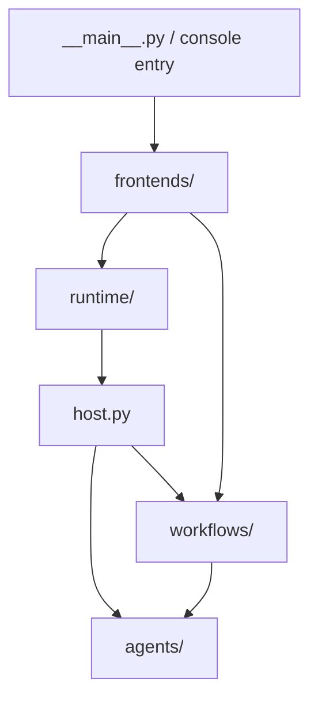

# codefox 源码结构

这里是 CodeFox 应用包。包根目录保存共享配置、Lead 入口和装配代码，具体能力按职责放入子目录。
本页说明直属文件和包之间的关系；子目录的文件分工由各自的 README 维护。

## 从哪里开始读

| 目录 | 职责与阅读入口 |
| --- | --- |
| [frontends/](frontends/README.md) | CLI 和 Textual 输入、显示及交互适配 |
| [runtime/](runtime/README.md) | 交互驱动、事件与审批、命令、会话存储、调度和 hooks |
| [agents/](agents/README.md) | Lead 与子 agent 的共享完整循环、执行策略、子 agent 生命周期、goal 和错误恢复 |
| [context/](context/README.md) | 提示词、历史压缩、memory 和技能加载 |
| [providers/](providers/README.md) | 模型 API 协议适配与消息内容读取 |
| [tools/](tools/README.md) | 基础工具、MCP 与工具注册机制 |
| [workspace/](workspace/README.md) | 任务板、任务分配及 Git 工作树 |
| [workflows/](workflows/README.md) | 程序化工作流、预算、journal 和恢复 |
| [skills/](skills/README.md) | 随包分发的技能指令与配套资源 |

## 根目录文件

| 文件 | 职责 |
| --- | --- |
| [__init__.py](__init__.py) | 标识 Python 包，不执行装配 |
| [__main__.py](__main__.py) | `python -m codefox` 入口，交给 `frontends.cli.main` |
| [core.py](core.py) | 启动目录、配置、模型客户端、常量、控制台协调器及技能资源路径 |
| [host.py](host.py) | Lead 的 `agent_loop` 与显式 `initialize_runtime`；装配共享引擎与 Lead 策略，提供流式请求、goal 和记忆入口 |
| [registrations.py](registrations.py) | 组合 Lead 工具清单与专有定义，共用工具定义委托 `tools/shared_tools.py` |
| [runtime_context.py](runtime_context.py) | 每次模型调用前，从 memory、MCP 和子 agent 状态构造上下文快照 |

能力调用直接导入所属模块，`host.py` 不重导出工具与任务 API。

## 主要执行关系

这张图表示主要入口，不表示全部依赖。各目录是职责分组，不是严格的单向依赖层。
前端把输入交给共享交互运行时，运行时通过宿主执行 Lead 回合。
Lead 与子 agent 复用 `agents/` 的执行循环，工作流复用子 agent 能力。

## 放置代码的边界

- 前端负责输入和呈现，不复制后端命令、会话切换或 agent 执行规则。
- 工具注册机制在 `tools/`，具体工具清单在本层 `registrations.py`，宿主完成装配。
- 任务和工作树关联放在 `workspace/`；模型协议放在 `providers/`；上下文处理放在 `context/`。
- 技能加载实现放在 `context/`；技能指令与资源放在 `skills/`。
- 新职责子包的 `__init__.py` 只包含包说明，不执行装配或重新导出；直接导入具体模块。

源码布局说明见 [上级 README](../README.md)，安装和使用见 [项目 README](../../README.md)。
